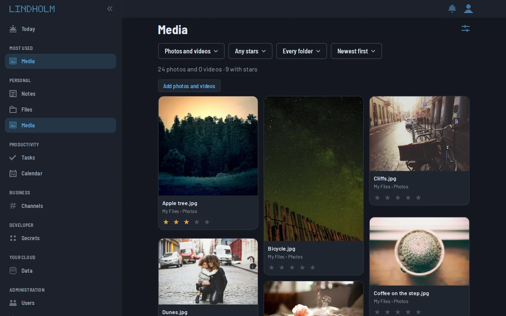
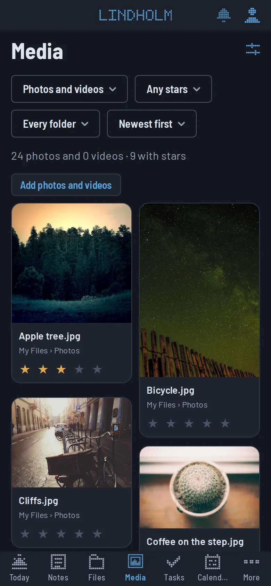
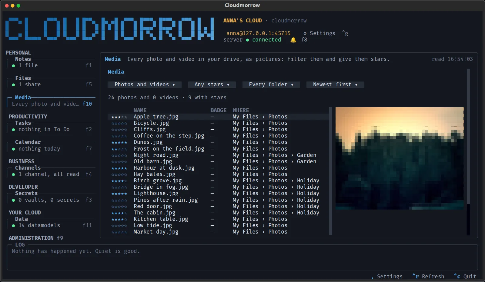
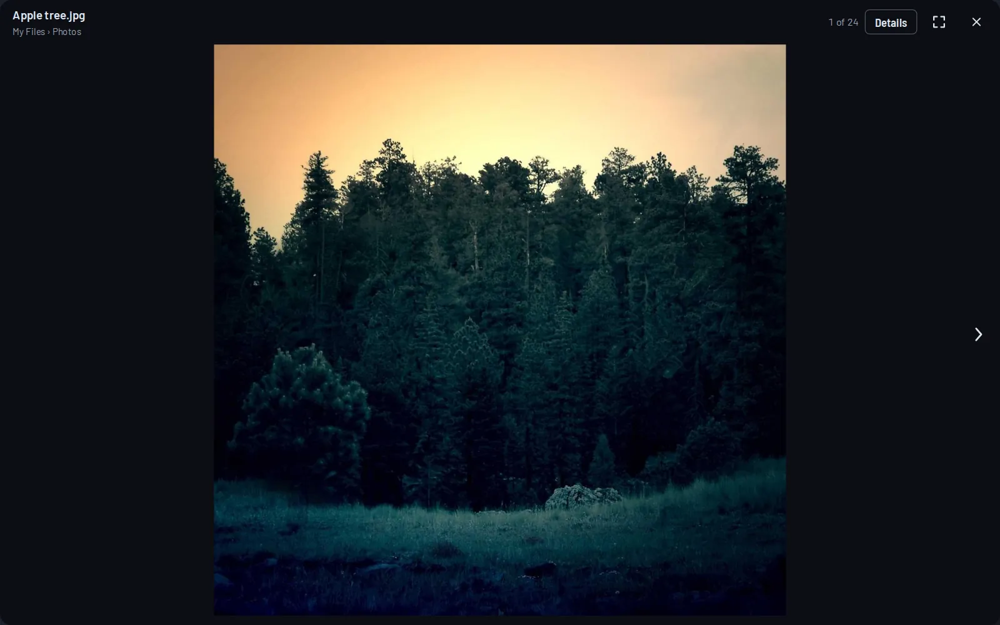
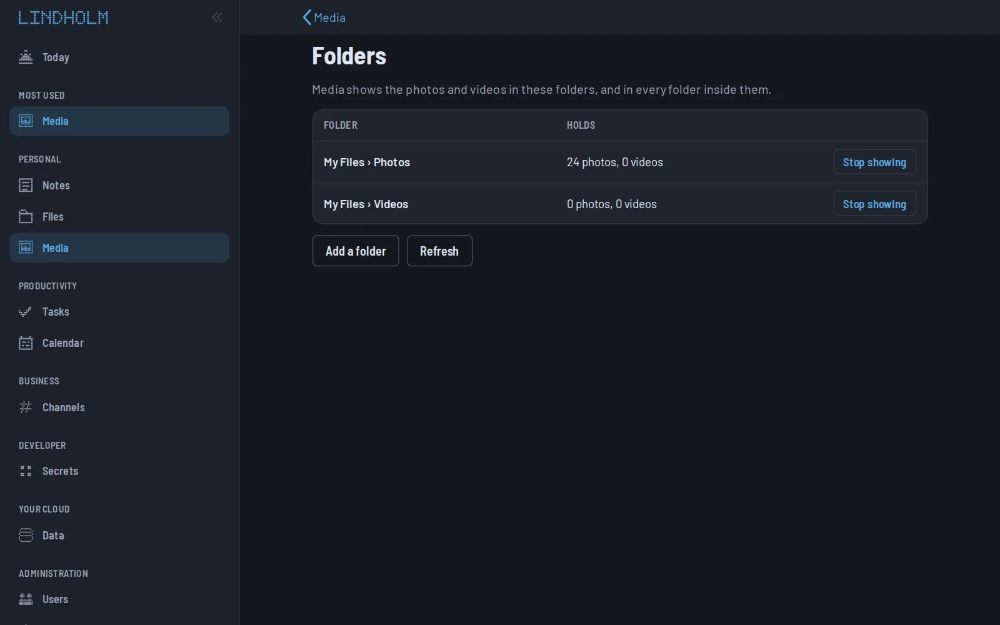

# Media

Every photo and video in your drive, as pictures: filter them and give them
stars. A [Quill](https://github.com/Cloudmorrow/cloudmorrow/blob/main/docs/QUILLS.md)
for Cloudmorrow, drawn on the phone, in the web app, in the terminal and on
the command line by Cloudmorrow itself.

## Screens

The wall, in a browser, on a phone and in the terminal:

<p>


</p>


One opened, and the Folders settings behind the gear:

<p>


</p>

(Stock photos from picsum.photos, on a throwaway cloud made for the pictures.)

## How it works

1. Open **Media**: every photo and video in My Files › Photos and
   My Files › Videos, and in every folder inside them, as a wall of
   pictures at their own shapes, newest first, packed the way a pinboard
   is. A video's picture is a frame of it, with ▶ Video on it.
2. Press a picture and it opens across the screen: the photo, or the video
   playing. The arrows at its sides (or ← and →, or a swipe) go to the next
   and the one before; the button at the top right fills the whole screen;
   **Details** is the file's own sheet, with what other Quills add to a
   file — Clipper's **Edit this video**, say.
3. Tap the stars under one to give it 1 to 5; tap the lit one again to take
   them away. In the terminal, 0 to 5 on the row you are on.
4. Filter with the menus above: photos or videos, how many stars at least,
   one folder; sort newest or oldest first, by name, or by stars.
5. Drop photos and videos from your computer onto the wall, paste them, or
   press **Add photos and videos**: photos go to My Files › Photos and
   videos to My Files › Videos (made if they are not there yet), and the
   wall shows them. Anything else is left out and said so.
6. The gear beside the title opens **Folders**, your settings. **Add a
   folder** opens the drive: My Files or any share, then the folders in
   it, as deep as you like; the button at the bottom adds the one open,
   and its subfolders come with it. **Stop showing** takes a folder away
   again. Nothing in a folder is ever changed or deleted by Media.

## What it adds to your Cloudmorrow

| | |
| --- | --- |
| Datamodels | uses the foundational `file`; introduces `media.rating` (the stars you gave a file, by its id) and `media.folder` (a folder Media shows; everybody starts with Photos and Videos) |
| Screens | Media (a view: the wall, its filters, the viewer a picture opens, and the upload of what is dropped on it) and Folders (your settings, behind the gear beside the title) — on the phone, the web app, the terminal, `cm media`, and to your assistant |
| Actions | Rate (on a file: 0 to 5 stars), Add a folder (picked from the drive, on the Folders screen), Stop showing (a folder), Refresh |
| Code | `quill.py`, in the sandbox, as whoever uses it; reaches nothing outside |
| Runtimes | **ffmpeg**, which the install brings (`[requires] runtimes`): the server draws each video's thumbnail with it. Without it a video shows as a plain tile |

Media needs no other Quill. Clipper requires it: installing Clipper
installs Media first.

## Working on it

```
uv sync                  # .venv with Cloudmorrow and pytest
cm quill check           # the manifest, as a server would install it
cm quill test            # tests/, against the real record store and gate
cm quill test --sandbox  # the same, with quill.py in the sandbox
cm quill dev --local     # a throwaway server here, reinstalled as you save
```

The pictures in `screenshots/` (`<screen>-desktop.webp` 1600×1000,
`<screen>-phone.webp` 780×1688, `<screen>-tui.webp` 1600×930, captioned in
quill.toml's `[[screenshots]]`) are taken from a throwaway cloud seeded with
stock photos, never from anybody's own cloud. Retake them when a screen
changes.
